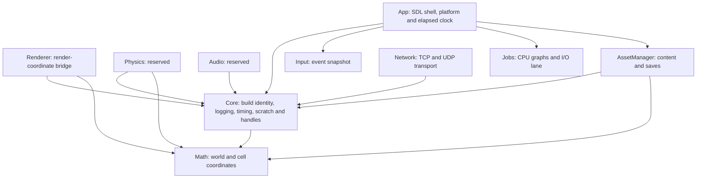

# Architecture and ownership

## Implemented at 0.0.7

App owns SDL video, the window and the main-thread event loop. Input keeps a per-batch snapshot of keyboard and mouse state. Core supplies build metadata, diagnostic logging, explicit fixed simulation ticks, frame scratch leases and generation-checked handles. App owns target detection and the SDL elapsed clock. Math implements checked world/cell conversions. Renderer has a CPU-only bridge for camera-relative coordinates. Jobs provides an opt-in enkiTS CPU scheduler, a dedicated SDL I/O thread and a bounded owner-drained completion queue. AssetManager owns the PhysicsFS content mounts and save directory. Network owns an opt-in Asio transport with owner-pumped TCP and UDP completions. Physics and Audio are interface reservations.

Arrows mean permitted direct engine-module dependency. App may depend on every module when its implementation needs them; at this milestone it links Core, Input, Jobs and AssetManager. Third-party targets are separate from this graph. Core's only external libraries are fmt/spdlog. Never initialize an upper-level module from Core.

## Planned runtime contracts

- The application/simulation owner manages mutable world state, entity lifetimes and the single Luau VM.
- Submit blocking reads to the dedicated I/O lane. CPU and I/O results return to the owner through a bounded queue. Future streamers will attach generation identifiers to reject stale results.
- The render owner alone manages Diligent GPU state, uploads, frame consumption and fence-safe retirement. The scene producer publishes immutable packets and stops mutating them after submission.
- Physics advances at a fixed simulation step; audio callbacks never block or execute scripts; networking returns transport completions to its owner for later gameplay integration.
- Rendering will use offsets from the render origin to keep nearby GPU coordinates precise. Terrain, foliage and water will share the world/cell coordinate contract.
- Terrain residency separates CPU-ready, render-ready, collision-ready and active states. Foliage uses deterministic generation and bounded GPU-visible instances. Ocean simulation has CPU-equivalent queries for gameplay.

The job lanes are available now. World streaming, render packets, and subsystem consumers are planned for later milestones. CryEngine-specific classes, render-pass APIs, shader extensions and caches apply only when editing CryEngine; WiseEngine uses Diligent and HLSL through its own future abstractions.
