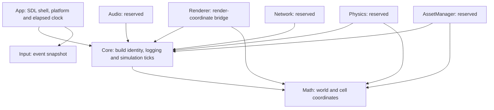

# Architecture and ownership

## Implemented at 0.0.3

App owns SDL video, the window and the main-thread event loop. Input keeps a per-batch snapshot of keyboard and mouse state. Core supplies build metadata, diagnostic logging and explicit fixed simulation ticks. App owns target detection and the SDL elapsed clock. Math implements checked world/cell conversions. Renderer has a CPU-only bridge for camera-relative coordinates. Physics, Audio, Network and AssetManager are interface reservations.

Arrows mean permitted direct engine-module dependency. App may depend on every module when its implementation needs them; at this milestone it links Core and Input. Third-party targets are separate from this graph. Core's only external libraries are fmt/spdlog. Never initialize an upper-level module from Core.

## Planned runtime contracts

- The application/simulation owner manages mutable world state, entity lifetimes and the single Luau VM.
- Dedicated I/O workers handle blocking reads; CPU jobs prepare immutable results and return bounded completion messages with generation identifiers.
- The render owner alone manages Diligent GPU state, uploads, frame consumption and fence-safe retirement. The scene producer publishes immutable packets and stops mutating them after submission.
- Physics advances at a fixed simulation step; audio callbacks never block or execute scripts; networking publishes transport messages without directly changing the world.
- Rendering will use offsets from the render origin to keep nearby GPU coordinates precise. Terrain, foliage and water will share the world/cell coordinate contract.
- Terrain residency separates CPU-ready, render-ready, collision-ready and active states. Foliage uses deterministic generation and bounded GPU-visible instances. Ocean simulation has CPU-equivalent queries for gameplay.

These ownership and resource contracts are design requirements for later milestones. No threads or renderer exchange types implementing them exist at 0.0.1. CryEngine-specific classes, render-pass APIs, shader extensions and caches apply only when editing CryEngine; WiseEngine uses Diligent and HLSL through its own future abstractions.
