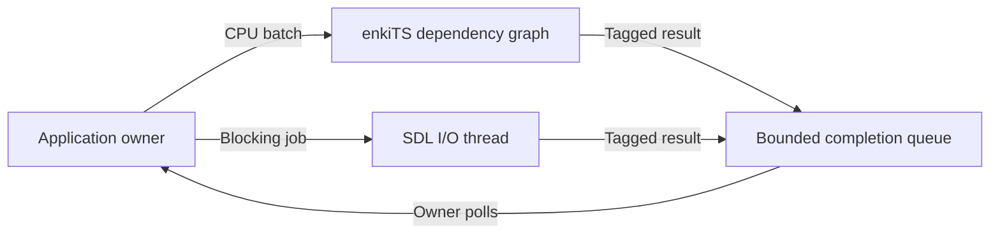

# WiseEngine 0.0.4

## Section 1 – C++ Code

`src/Jobs/JobSystem.h` exposes the owner-thread API. `src/Jobs/JobSystem.cpp` owns two execution lanes. enkiTS schedules finite CPU jobs in directed acyclic batches. A dedicated SDL thread waits on a condition variable and processes blocking I/O jobs in submission order. Both lanes publish tagged, owned byte buffers or a captured exception to the same completion queue.

Each CPU node lists zero-based prerequisite indices in ascending order, with no duplicates. Every prerequisite must precede the node in its batch. Dependencies order execution and completion publication. A failed prerequisite still satisfies the ordering edge, so code that requires successful output should have the owner submit a follow-up batch after checking the result. Cross-batch and cross-lane dependencies are expressed by the owner after polling.



## Section 2 – Build Configuration

The `Jobs` module privately links the pinned SDL and enkiTS targets. Its public header uses standard C++ types. App may link Jobs and Core remains independent. The new contract and command-line tests build when `WISEENGINE_BUILD_TESTS` is enabled.

## Section 3 – Scripts

From the engine root run `python cmake/VerifyThirdParty.py`, then `./build.ps1 -Config Debug -Target all -Tests` and repeat with `-Config Release`. After committing and tagging, run `python cmake/BackupMilestone.py --version 0.0.4`. The backup command verifies its manifest and files by reading them back before it publishes the ZIP and checksum.

## Section 4 – Documentation

- Construct and use the scheduler on one owner thread. Callbacks must finish independently of the owner, avoid accessing mutable owner state, and never call back into the scheduler. Pass immutable snapshots or synchronize explicitly if jobs share data.
- At most 64 jobs may be accepted without their completions being consumed. Running, queued, and completed-but-unread jobs all reserve a slot. Admission returns `Full` without moving the callback when the limit is reached. Polling returns one slot. The queue bounds the number of entries. Callers control payload sizes and must budget the memory in captures and returned byte buffers.
- `shutdown()` closes admission, drains accepted work, and joins both lanes. The owner may help execute CPU tasks during shutdown. Poll remains available until destruction. A blocked I/O callback must eventually return for shutdown to finish. There is one I/O thread per service and no cancellation or interruption API in this increment.
- The caller selects 1–16 enkiTS CPU workers. Each constructed service also has one I/O thread. Enqueueing graphs allocates their nodes and edges. Queue storage is preallocated and each completion takes a short mutex lock. Ordinary interactive shell startup leaves the scheduler off until a subsystem requests it.

Debug and Release incremental builds each passed all 14 CTest cases. The scheduler contract test also passed 100 consecutive runs in each configuration. The isolation test holds an I/O callback in a blocking wait while a CPU dependency graph runs. The headless CLI probe succeeds with an invalid SDL video driver.

## Section 5 – Usage Examples

```powershell
.\build\debug\bin\WiseEngine.exe --job-smoke
```

From C++, construct `CE::Jobs::JobSystem jobs(2)` on the owner thread. Pass a `std::vector<CE::Jobs::CpuJob>` to `submitCpu` and tag each node so the owner can correlate its result. Call `submitIo` for a blocking read. Use `poll()` on the owner, check `Completion::error` before consuming `bytes`, and retry a full submission after consuming results. Keep callback state alive until completion or shutdown.
